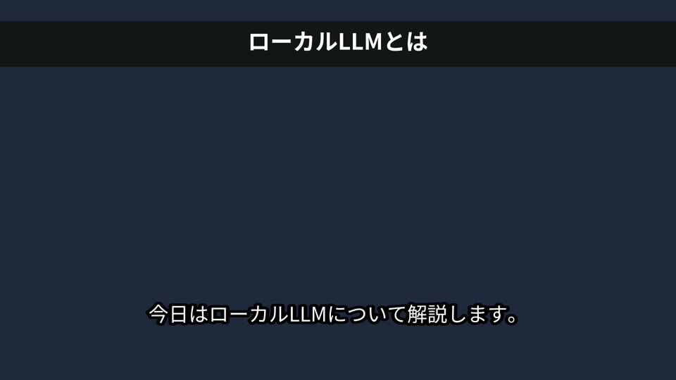
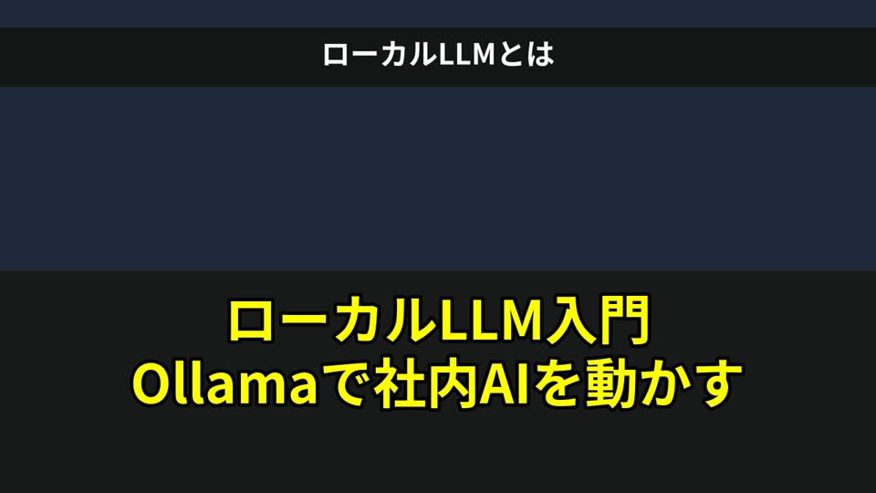
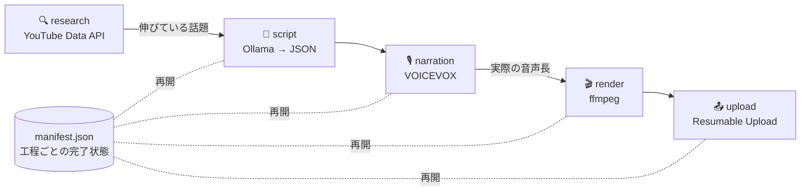

# Video Automation Pipeline

**トレンド調査 → AI台本 → ナレーション → 自動編集 → YouTube投稿 までを1コマンドで回す動画制作パイプライン**

人手で数時間かかっていた解説動画の制作工程を自動化し、途中で失敗しても**完了済みの工程を再実行しない**再開可能な設計にしています。生成AIはローカル（Ollama / VOICEVOX）で動かすため、API課金なしで量産できます。

> English: An end-to-end, resumable pipeline for explainer videos — YouTube Data API trend research, LLM script generation with schema validation, VOICEVOX narration with subtitle timing taken from the real audio, ffmpeg rendering (captions, burned-in subtitles, BGM auto-ducking, −14 LUFS loudness), and chunked resumable upload with retry/backoff.

| 完成動画のフレーム | 自動生成サムネイル |
|---|---|
|  |  |

*（テスト用の背景・音声で生成したもの。字幕・見出し・サムネイル文字はすべて自動配置）*

---

## パイプライン全体像



| 工程 | やっていること | 工夫した点 |
|---|---|---|
| **research** | キーワードで直近の動画を取得し、伸びている話題を抽出 | 再生数ではなく**再生速度（再生数/経過時間）×エンゲージメント**で評価。昔のヒット動画に引っ張られない。API quota を節約するため search 1回＋videos 1回に集約 |
| **script** | タイトル・説明文・タグ・シーン構成をLLMがJSONで出力 | スキーマ検証（文字数・禁止文字・シーン数）に失敗したら**エラー内容を添えて再生成**。タグはYouTubeの500文字制限内に自動調整 |
| **narration** | シーンごとに音声合成 | 字幕のタイミングを文字数の推定ではなく**生成した音声の実測長**から算出するので、声と字幕がずれない |
| **render** | シーン動画 → 結合 → 字幕焼き込み・BGM・音量正規化 → サムネイル | BGMは**サイドチェインで声が出ている間だけ自動で下がる**。YouTube基準の −14 LUFS に正規化。サムネイルの長いタイトルは単語や数字の途中で切らずに2行へ自動改行 |
| **upload** | YouTubeへ分割アップロード | 5xx・通信断では**サーバーに受信済みバイト数を問い合わせて続きから再送**（指数バックオフ）。初期値は**非公開**、予約公開にも対応 |

## 使い方

```bash
pip install -e .
cp .env.example .env   # APIキー・OAuth情報を設定

# 1. 話題を調べる
vidpipe research "生成AI" --days 14

# 2. テーマを指定して動画を作る（アップロードはしない）
vidpipe make --topic "ローカルLLM入門" --scenes 5 --bgm assets/bgm.mp3

# 3. script.json を手で直してから、描画以降だけやり直す
vidpipe make --job jobs/20261029-0930-ローカルLLM入門 --from render

# 4. 調査→制作→予約投稿まで一気に
vidpipe run --seed "生成AI" --upload --publish-at 2026-11-01T19:00:00+09:00

# ffmpegコマンドだけ確認したいとき
vidpipe make --topic "テスト" --dry-run
```

ジョブごとにディレクトリが作られ、中間生成物と進捗がすべて残ります。

```
jobs/20261029-0930-ローカルLLM入門/
  manifest.json     工程ごとの完了状態と出力（再開の根拠）
  script.json       生成された台本（手修正可）
  audio/            シーン別ナレーション
  clips/            シーン別動画
  subs.srt          字幕
  final.mp4         投稿用動画
  thumb.jpg         サムネイル
```

### 定期実行の例（cron）

```cron
# 毎週月曜 6:00 に調査→制作→非公開アップロード。公開は人が確認してから
0 6 * * 1  cd /opt/vidpipe && .venv/bin/vidpipe run --seed "生成AI" --upload >> logs/run.log 2>&1
```

## テスト

```bash
pip install -e ".[dev]"
pytest -q     # 19 tests（ffmpegがあれば実際にMP4を書き出して検証）
```

| テスト | 検証内容 |
|---|---|
| `test_pipeline_e2e.py` | **実際のffmpegでMP4を生成**し、解像度・音声トラック・長さが音声合計と一致することを確認。2回目の実行で台本生成・音声合成が再実行されないこと（再開性） |
| `test_uploader.py` | 疑似YouTubeサーバーで途中に503を返し、**受信済み位置から正しく再開できること**。予約公開時に非公開が強制されること |
| `test_research.py` | 再生速度が累計再生数より優先されること、単発の語を話題扱いしないこと |
| `test_script_and_narration.py` | 不正JSONの再生成、字幕が音声の境界に揃うこと、SRT形式、サムネイル改行 |

LLM・TTS・YouTube APIはすべてテストダブルに差し替えているため、APIキーなしでCIが回ります。

## 構成

```
src/vidpipe/
  research.py    YouTube Data API v3 による調査とスコアリング
  script.py      LLM台本生成とスキーマ検証
  narration.py   VOICEVOX連携、字幕タイミング、SRT出力
  editor.py      ffmpegコマンド生成（純粋関数）と実行
  uploader.py    OAuth2 + Resumable Upload
  pipeline.py    工程管理と manifest による再開
  cli.py         コマンドライン
```

## 運用上の配慮

- **非公開がデフォルト**：AI生成物は必ず人が確認してから公開する前提
- 秘密情報は環境変数のみ。`.gitignore` で OAuth トークンやジョブ出力をコミット対象外に
- 生成台本には「事実が不確かな数値・固有名詞を書かない」制約を入れ、誤情報リスクを抑制
- 背景素材・BGMは利用許諾を確認したものだけを使うこと

## License

MIT
